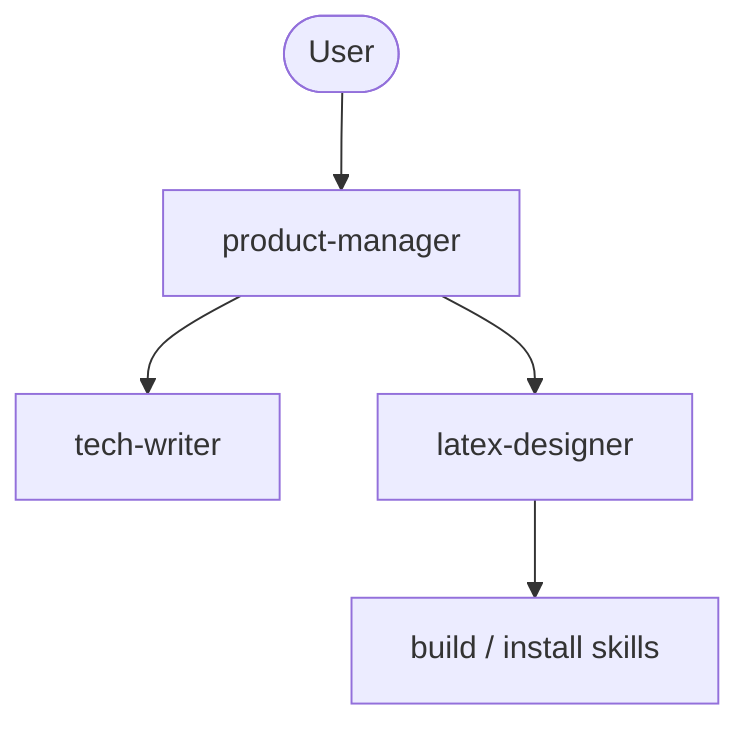

# AI Agents Architecture

This document describes the multi-agent orchestration setup for generating LuaTeX programming presentations.

## Pipeline Overview

---

## Team Roster

### 1. product-manager (`mode: primary`)
* **Role:** Team orchestrator, supervisor, and user-facing interface.
* **Responsibilities:**
  * Gathers requirements from the user in English.
  * Writes prompts and manages task IDs for subagents.
  * Validates the final build via `install` skill.
* **Context Access:** `install` skill.

### 2. tech-writer (`mode: subagent`)
* **Role:** Subject-matter expert and fact-checker.
* **Responsibilities:**
  * Prepares structured presentation plans based on PM requirements.
  * Writes final slide content and code listings in Russian Markdown.
  * Saves drafts to `build/drafts/`.
* **Context Access:** `websearch`, `webfetch` tools. Fully isolated from LaTeX.

### 3. latex-designer (`mode: subagent`)
* **Role:** Typesetter and build system engineer.
* **Responsibilities:**
  * Converts Markdown from `tech-writer` into clean LuaTeX code.
  * Manages directory structures, code files in `src/`, and updates `Makefile`.
  * Fixes compilation issues and visual overflows.
* **Context Access:** `build`, `luatex-document`, `luatex-presentation` skills.

---

## Communication & Iteration Rules
1. **Content First:** `tech-writer` must deliver full content before `latex-designer` starts layout.
2. **Layout Overflows:** If content doesn't fit a slide at `\small`, `latex-designer` signals `product-manager` to request a text split from `tech-writer`.
3. **Strict Validation:** `product-manager` only accepts the task after a successful Nix production build check.
